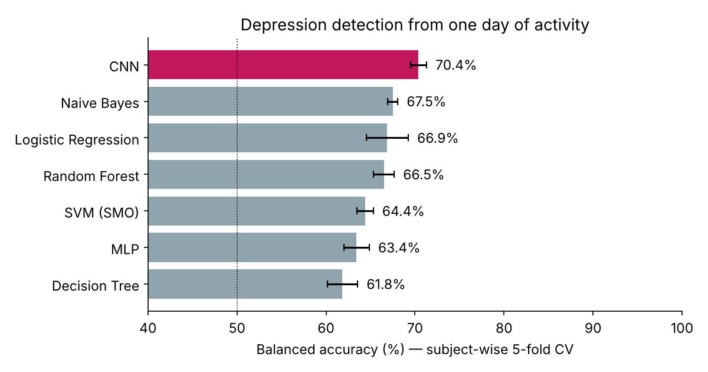
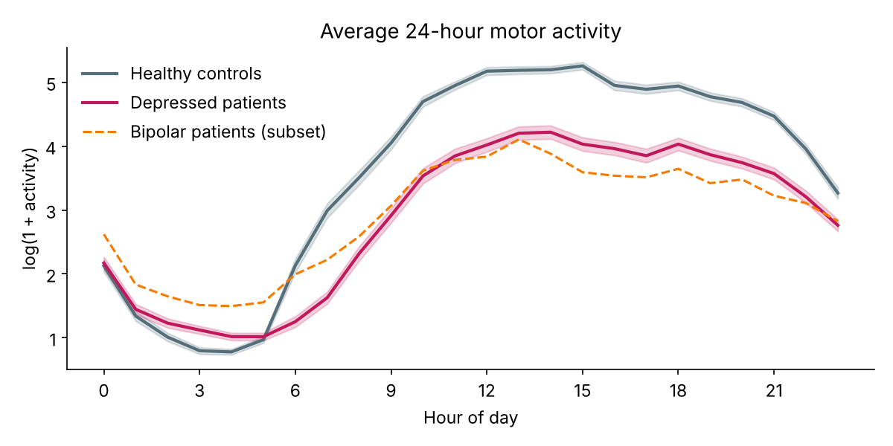
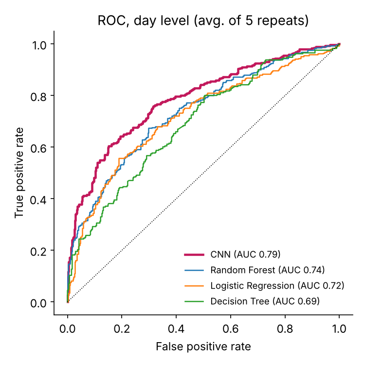
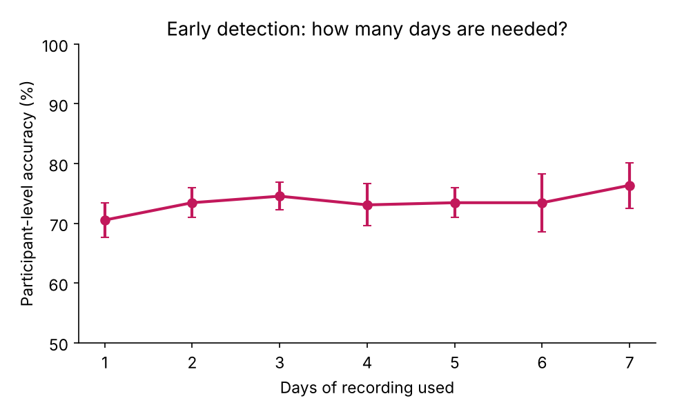
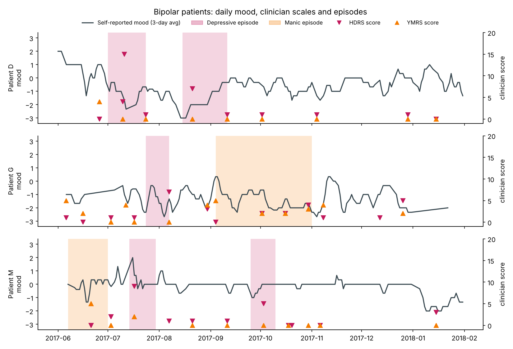
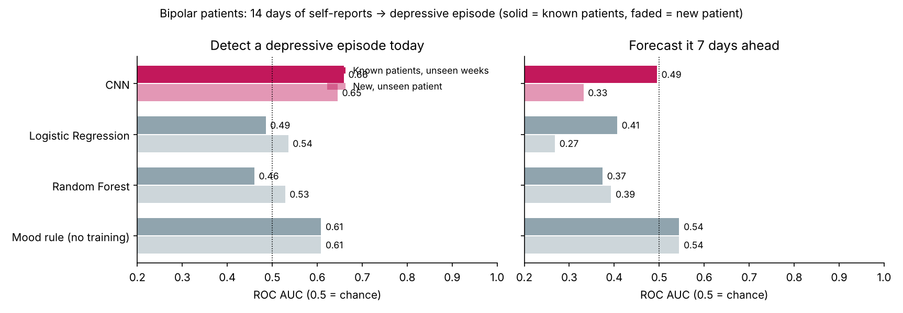
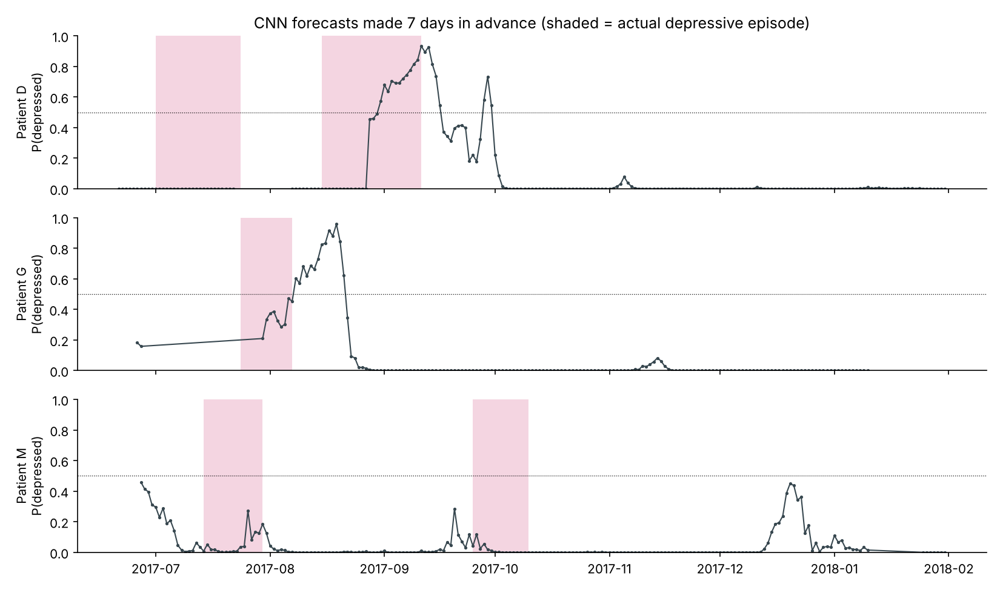
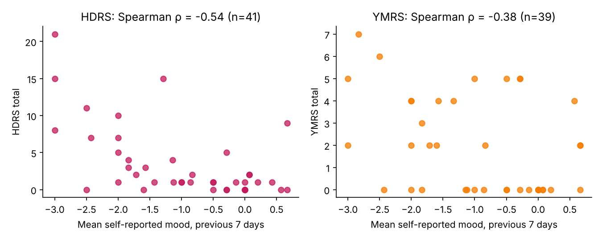

# Forecasting Depression in Bipolar Disorder Using a Convolutional Neural Network

**Website and live demo:** https://abbasisarah.github.io/depression-bipolar_CNN/

This project has two parts:

1. **Part 1 – Depresjon (55 people):** a 1-D Convolutional Neural Network (CNN) that detects
   depressive episodes in unipolar and bipolar patients from **one day of wrist-worn
   motor-activity (actigraphy) data**.
2. **Part 2 – Bip4cast bipolar patients:** a multichannel CNN that uses 14 days of a bipolar
   patient's **daily self-report questionnaire** to detect, and try to *forecast* 7 days ahead,
   depressive episodes. It also checks the self-reports against the clinician-rated
   **YMRS** (mania) and **HDRS** (depression) scales.

Both CNNs are written **from scratch in NumPy**: no deep-learning
framework is used. That way every algorithm in the pipeline is visible and explained,
and its gradients are verified numerically.

The CNN is compared with the conventional machine-learning algorithms from the
thesis proposal (Naive Bayes, Logistic Regression, MLP, SVM/SMO and Decision Tree,
plus Random Forest), all under the same patient-independent evaluation.



## Part 1 – Key results

Evaluation: 5-fold cross-validation **grouped by participant**, so the model is always
tested on people it has never seen, repeated 5 times with different splits
(mean values shown).

| Model | Accuracy % | Balanced acc. % | F1 | AUC | MCC | Participant acc. % | Recall bipolar % | Recall unipolar % |
|---|---|---|---|---|---|---|---|---|
| **1-D CNN (ours)** | **71.0** | **70.4** | **0.66** | **0.77** | **0.41** | 73.1 | **73.2** | **62.7** |
| Naive Bayes | 69.7 | 67.5 | 0.60 | 0.76 | 0.37 | 68.0 | 61.5 | 49.2 |
| Logistic Regression | 67.6 | 66.9 | 0.62 | 0.71 | 0.34 | 71.3 | 62.4 | 62.5 |
| Random Forest | 67.6 | 66.5 | 0.61 | 0.73 | 0.33 | 73.5 | 64.3 | 57.3 |
| SVM (SMO) | 66.2 | 64.4 | 0.57 | 0.69 | 0.30 | 70.9 | 56.7 | 50.8 |
| MLP | 65.2 | 63.4 | 0.56 | 0.67 | 0.28 | 73.1 | 51.7 | 52.5 |
| Decision Tree | 62.1 | 61.8 | 0.57 | 0.65 | 0.23 | 69.8 | 61.9 | 58.9 |

* The CNN gives the best day-level result on every metric. It learns its own features
  from the raw 24-hour signal, while the other models use 34 hand-crafted features.
* It identifies **73% of the days recorded from bipolar patients** (bipolar I and II),
  the highest of all models.
* **Early detection:** averaging the CNN's prediction over a participant's first
  *k* days classifies the participant correctly **70.5% of the time after 1 day,
  74.5% after 3 days and 76.4% after 7 days**.
* **Severity (MADRS score) prediction does not work yet.** No model beat simply
  predicting the average score (mean absolute error: CNN 4.36, Random Forest 4.17,
  average baseline 4.14 MADRS points). With only 23 patients, activity alone does
  not carry enough information to grade severity. See *Limitations*.

| | | |
|---|---|---|
|  |  |  |

Depressed patients move clearly less during the day and have a flatter daily rhythm
than healthy controls. Bipolar patients are also more active at night. This is the
pattern the CNN picks up.

## Part 2 – Forecasting depressive episodes in bipolar patients

**Data:** anonymised records of bipolar patients treated at Clínica Nuestra Señora de la Paz,
Madrid (Bip4cast project), published by Junestrand (2018). It includes:
* daily questionnaires: mood, motivation, attention, irritability, anxiety, sleep, cigarettes,
  caffeine, wake-up and bed times
* clinician ratings on the **YMRS** (Young Mania Rating Scale, 11 items) and the
  **HDRS-17** (Hamilton Depression Rating Scale)
* the dates of every depressive and manic episode

Three patients (D, G and M) have labelled episodes. Patient O had constantly mixed episodes and
was excluded, as the psychiatrist recommended. That leaves 582–596 sliding 14-day windows, about
92 of which are followed by a depressive episode.

**Model:** `DiaryCNN` is a multichannel 1-D CNN: 11 questionnaire items × 14 days → Conv(k=3) →
MaxPool → Conv(k=3) → Global Average Pooling → Dense. It is an average of 5 networks trained
from different starting points.

**Evaluation:**
* *Known patients, unseen weeks:* blocked time-series cross-validation, with a 21-day buffer
  around each test block.
* *New patient:* leave-one-patient-out.



| ROC AUC (0.5 = chance) | Detect episode today, known patients | Detect today, new patient | Forecast 7 days ahead, known patients | Forecast 7 days, new patient |
|---|---|---|---|---|
| **DiaryCNN (ours)** | **0.66** | **0.65** | 0.49 | 0.33 |
| Logistic Regression | 0.49 | 0.54 | 0.41 | 0.27 |
| Random Forest | 0.46 | 0.53 | 0.37 | 0.39 |
| Mood rule (low mood in last 7 days, no training) | 0.61 | 0.61 | 0.54 | 0.54 |



**What this shows:**
* **Self-reports match the clinicians.** A patient's average self-reported mood over the 7 days
  before an appointment correlates with their **HDRS depression score (Spearman ρ = −0.54,
  p = 0.0003, n = 41)** and, more weakly, with their **YMRS score (ρ = −0.38, p = 0.018, n = 39)**.
  Daily questionnaires are therefore a valid way to monitor mood between appointments.
* **Detecting a current depressive episode works moderately.** The CNN is the best model
  (AUC 0.65–0.66), and it also works for a patient it has never seen.
* **Forecasting 7 days ahead does not work with this data.** No model beats chance. The CNN's
  "forecasts" rise only once an episode has already started (see below), so it recognises
  depression but cannot anticipate it. With only 3 patients and 5 depressive episodes (29
  "new-episode" windows), there are too few examples of what the run-up to an episode looks like.
  We also tried standardising each patient against their own baseline; it did not help.




## Dataset (Part 1)

**Depresjon** (Garcia-Ceja et al., 2018). Actiwatch motor-activity counts were recorded
every minute for 23 depressed patients (15 unipolar, 7 bipolar II, 1 bipolar I) and
32 healthy controls. Depression severity was rated by clinicians on the
Montgomery–Åsberg Depression Rating Scale (MADRS).

After cutting the recordings into whole calendar days there are **693 days**:
291 from patients, 108 of them from bipolar patients. See [`data/README.md`](data/README.md)
for the source, terms of use and citation.

## Method

```
raw 1-min counts (1440/day) ─► log(1+x) ─► 5-min bins (288/day) ─► standardise
      │
      ▼
Conv1D 1→16, k=9 ─► ReLU ─► MaxPool 4      (288 → 72)
Conv1D 16→32, k=5 ─► ReLU ─► MaxPool 4     (72 → 18)
Conv1D 32→32, k=3 ─► ReLU
Global Average Pooling ─► Dropout 0.3 ─► Dense 32→1 ─► sigmoid = P(depressed)
```

* **Training:** Adam (lr 0.002, weight decay 1e-4), 40 epochs, batch 32, class-balanced
  binary cross-entropy, random amplitude jitter (±10%) as data augmentation.
* **Implementation:** every layer has its own forward and backward pass
  ([`src/depresjon_cnn/cnn.py`](src/depresjon_cnn/cnn.py)). Convolution uses im2col.
  `tests/test_cnn.py` checks all gradients against finite differences.
* **Baselines:** 34 features per day (mean, SD, median, max, share of inactive minutes,
  night and day activity, day/night ratio, 24 hourly means, peak hour), fed to scikit-learn models.
* **No data leakage:** a participant's days never appear in both training and test data.
  Studies that split *days* at random report about 99% accuracy on this dataset because
  the model recognises the person rather than the depression.

## Run it

Requires Python 3.10+.

```bash
git clone <this-repo-url>
cd <repo-folder>
pip install -r requirements.txt

python tests/test_cnn.py           # gradient check (a few seconds)
python run_experiments.py          # all experiments + figures (~6 min on a laptop CPU)
python run_experiments.py --quick  # fast smoke test (~1 min)
python run_forecasting.py          # Part 2: bipolar forecasting (~3 min)

python predict.py data/condition/condition_5.csv   # score one recording
```

Outputs go to `results/`: `metrics.json`, `detection_metrics.csv`, `forecasting_metrics.json`,
`figures/*.png`, and the trained Part 1 weights in `cnn_weights.npz`.

## Repository structure

```
├── data/                    Depresjon dataset (condition/, control/, scores.csv)
│   └── bdcp/                Bip4cast bipolar patients (episodes, diary, YMRS, HDRS)
├── src/depresjon_cnn/
│   ├── data.py              Part 1: loading, daily windows, preprocessing
│   ├── features.py          Part 1: hand-crafted features for the baselines
│   ├── bipolar_data.py      Part 2: cleaning the bipolar records, 14-day windows
│   └── cnn.py               NumPy CNNs (ActivityCNN, DiaryCNN), layers, Adam
├── tests/test_cnn.py        numerical gradient check
├── run_experiments.py       Part 1: detection, early-detection and severity experiments
├── run_forecasting.py       Part 2: detection / 7-day forecasting, YMRS & HDRS analysis
├── predict.py               apply the trained model to a new recording
└── results/                 metrics and figures (generated)
```

## Limitations and future work

* **Small samples:** Part 1 has 55 people, only 8 of them bipolar; Part 2 has just 3 bipolar
  patients. Both are proofs of concept with wide uncertainty.
* **Forecasting needs more patients:** Part 2 shows that self-reports track depression, but
  anticipating an episode a week in advance would need many more patients and episodes. Combining
  passive sensing (Part 1) with daily self-reports (Part 2) for the same people is the natural
  next step.
* **Severity:** MADRS could not be predicted from activity alone. Combining activity with
  self-reported mood, sleep times and clinical scales is the natural next step.
* Not a medical device. Do not use it for diagnosis.

## Citation

Part 2 data and dataset description: A. Junestrand Leal, *Application of Machine Learning
Algorithms for Bipolar Disorder Crisis Prediction*, Bachelor's thesis, Universidad Complutense de
Madrid, 2018. Data: https://github.com/AxelJunes/BDCP (Apache-2.0), Bip4cast project.

If you use the Depresjon dataset, cite:

> E. Garcia-Ceja, M. Riegler, P. Jakobsen, J. Tørresen, T. Nordgreen, K. J. Oedegaard,
> O. B. Fasmer. *Depresjon: A Motor Activity Database of Depression Episodes in Unipolar
> and Bipolar Patients.* Proceedings of the 9th ACM Multimedia Systems Conference (MMSys), 2018.
> doi:10.1145/3204949.3208125

## License

Code: MIT (see `LICENSE`). Data: Depresjon terms (research and education only), see `data/README.md`; Bip4cast/BDCP data under
Apache-2.0, see `data/bdcp/README.md`.
